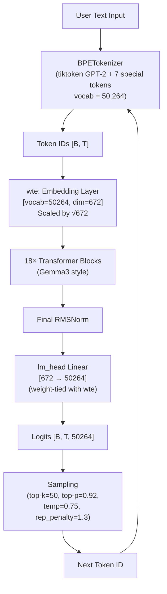
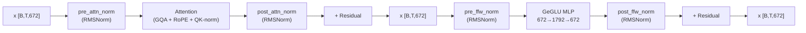
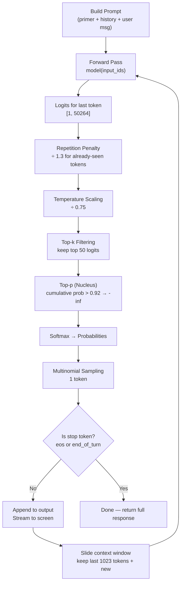

# KeeKee v3 — Full Technical Deep-Dive

---

## 1. What Is KeeKee?

KeeKee is a **130M parameter, decoder-only transformer** built from scratch in PyTorch. It is a fully custom implementation inspired by Google's Gemma architecture. It was pre-trained on 1.3 million social conversations (SODA dataset) and then persona-fine-tuned to be a stable, empathetic AI chatbot with a persistent identity.

**Hardware:** NVIDIA RTX 4080 Laptop GPU, 12.5 GB VRAM  
**Framework:** PyTorch 2.x, Python 3.11  
**Final checkpoint:** `TRAIN/checkpoints/keekee_identity.pt` — val_loss **1.6978**

---

## 2. Complete File Map

```
microgpt_v3/
├── config.py              # Model hyperparameters & presets
├── model.py               # Top-level KeeKee model class
├── attention.py           # GQA + sliding window + QK-norm attention
├── block.py               # Single transformer block (attn + FFW + residuals)
├── mlp.py                 # GeGLU feed-forward network
├── rope.py                # Rotary Position Embeddings (RoPE)
├── layers.py              # RMSNorm, Linear primitives
├── kv_cache.py            # KV cache for fast autoregressive inference
├── tokenizer.py           # BPE tokenizer (tiktoken GPT-2 base + custom tokens)
├── chat_keekee.py         # Production chat interface (streaming, identity primer)
├── sampler.py             # Advanced sampling strategies
├── sampling.py            # Top-p / top-k / temperature logic
├── router.py              # Tool/agent routing
├── run.py                 # Entry point runner
│
├── TRAIN/
│   ├── train.py                    # Base SODA pre-training script
│   ├── identity_finetune.py        # Persona fine-tuning script
│   ├── train.log                   # Training run logs
│   ├── identity_finetune.log       # Fine-tuning logs
│   └── convods/
│       ├── keekee_identity.jsonl   # Master fine-tune dataset (~2100 examples)
│       ├── name_boost.jsonl        # 49 name/identity examples (merged in)
│       ├── boost2.jsonl            # 110 behaviour/recall examples (merged in)
│       ├── soda_to_jsonl.py        # SODA → JSONL converter
│       ├── dataset.py              # Dataset utilities
│       └── SODA.py                 # HuggingFace SODA downloader
│
├── agent/agent.py         # Agentic tool-calling loop
├── rag/                   # Retrieval-Augmented Generation
├── mcp/                   # Model Context Protocol tool integration
└── tools/                 # Gmail + other tools
```

---

## 3. Architecture Overview



---

## 4. The 18 Transformer Blocks — Attention Pattern

Each of the 18 layers uses **alternating attention types** in a 5:1 ratio (Gemma3 style):

```
Layer:  1  2  3  4  5  6  7  8  9  10 11 12 13 14 15 16 17 18
Type:   L  L  L  L  L  G  L  L  L  L  L  G  L  L  L  L  L  G
        ↑ LOCAL_SLIDING             ↑ GLOBAL
```

- **LOCAL_SLIDING:** Each token can only attend to the **256 nearest tokens** (sliding window). Efficient for local context.
- **GLOBAL:** Full causal attention across the entire sequence. Captures long-range dependencies.

**Why this pattern?** LOCAL layers are faster and cheaper (O(n × window) vs O(n²)). The periodic GLOBAL layer ensures long-range information still flows through the network.

---

## 5. Single Block Internal Flow



**4 RMSNorms per block** (pre+post for attn, pre+post for FFW). This is the Gemma2/3 double-norm trick for training stability at scale.

---

## 6. Attention Module Deep Dive (`attention.py`)

### Grouped Query Attention (GQA)
- **Query heads:** 8 (`n_head=8`)
- **Key/Value heads:** 4 (`n_kv_head=4`)
- **GQA groups:** 2 (each KV head serves 2 Q heads)

**Why GQA?** Cuts the KV cache memory in half vs standard MHA. At inference, the 4 KV heads are `repeat_interleave`-d to match the 8 Q heads.

### QK-Norm
Before computing attention scores, both Q and K are passed through separate `RMSNorm` layers. This prevents attention logit explosion at large head dimensions — a Gemma3+ feature.

### Attention Logit Soft-Cap
```python
logits = torch.tanh(logits / 50.0) * 50.0
```
Squashes attention logits into `[-50, +50]`. Prevents extreme attention spikes that destabilize training.

### RoPE (Rotary Position Embeddings) — `rope.py`
Position information is encoded by **rotating** Q and K vectors. KeeKee uses **two separate frequency tables**:

| Layer Type | Base Frequency | Scale Factor | Purpose |
|-----------|----------------|--------------|---------|
| LOCAL | 10,000 | 1.0 | Standard near-context positioning |
| GLOBAL | 1,000,000 | 8.0 | Long-range positioning (Gemma3 global layers) |

The rotation formula for each dimension pair `(x1, x2)`:
```
x1_rotated = x1*cos(θ) - x2*sin(θ)
x2_rotated = x2*cos(θ) + x1*sin(θ)
```
Where `θ = position / base^(2i/head_dim)`.

### Flash Attention
For GLOBAL layers without logit capping, PyTorch's fused `F.scaled_dot_product_attention` kernel is used (FlashAttention v2). For LOCAL layers and where capping is needed, manual computation is done.

---

## 7. GeGLU Feed-Forward Network (`mlp.py`)

```
Input x [B,T,672]
    ↓
w_gate [672→1792] → GELU(gate) ⊙ w_val [672→1792]
    ↓
hidden [B,T,1792]
    ↓
w_out [1792→672]
    ↓
Output [B,T,672]
```

**Hidden dim formula:** `int(2/3 × 4 × 672)` rounded to nearest 64 = **1792**.

**Why GeGLU over standard ReLU FFW?** Gated activation functions empirically achieve ~10% lower loss at the same parameter count. The gate acts as a learned information filter — only passing through what the model thinks is relevant.

---

## 8. Tokenizer (`tokenizer.py`)

Base: **tiktoken GPT-2** (50,257 tokens) + **7 custom special tokens:**

| Token | ID | Purpose |
|-------|-----|---------|
| `<\|pad\|>` | 50257 | Padding for batch collation |
| `<\|bos\|>` | 50258 | Beginning of sequence |
| `<\|eos\|>` | 50259 | End of sequence |
| `<\|unk\|>` | 50260 | Unknown token |
| `<start_of_turn>user` | 50261 | Marks a user turn |
| `<start_of_turn>model` | 50262 | Marks a model/assistant turn |
| `<end_of_turn>` | 50263 | End of any turn |

**Chat turn encoding format (Gemma-style):**
```
[50261] \n Hello how are you [50263]   ← user turn
[50262] \n I'm good thanks! [50263]    ← model turn
```

---

## 9. Model Config (`config.py`)

**MODEL_130M (production):**
```python
n_layer  = 18      # 18 transformer blocks
n_embd   = 672     # embedding dimension (D)
n_head   = 8       # query attention heads
n_kv_head = 4      # key/value heads (GQA)
block_size = 2048  # max sequence length
sliding_window_size = 256
attn_logits_soft_cap = 50.0
rope_base_frequency = 10_000
```

**Parameter count breakdown:**
- Embedding: `50264 × 672 = 33.8M` (weight-tied, not counted in 130M)
- Per block: attention (`Q+K+V+O`) + FFW (`gate+val+out`) + 4 RMSNorms ≈ `7.2M`
- 18 blocks: `18 × 7.2M = ~129.6M`
- Final RMSNorm: negligible
- **Total: ~130M trainable params**

---

## 10. Training Script Deep-Dive (`TRAIN/train.py`)

### What it does
Trains the base model from scratch (or resumes) on the 1.3M SODA conversations.

### Key Hyperparameters
```
batch_size       = 4       (per GPU)
grad_accum_steps = 8       (effective batch = 32)
max_seq_len      = 1024
lr               = 3e-4    (peak)
min_lr           = 3e-5    (cosine floor)
warmup_steps     = 300
weight_decay     = 0.1
grad_clip        = 1.0
patience         = 5       (early stopping)
```

### Cosine LR Schedule
```
Phase 1 (warmup): LR rises linearly from 0 → 3e-4 over 300 steps
Phase 2 (cosine): LR decays from 3e-4 → 3e-5 following cosine curve
Phase 3 (floor):  LR stays at min_lr = 3e-5 after total_steps
```

### Loss Masking (Critical)
Only **assistant tokens** contribute to the cross-entropy loss. User tokens are masked with `-100`.

```python
# User turn: labels = [-100, -100, -100, ...]  ← masked
# Asst turn: labels = [tok_id, tok_id, ...]    ← supervised
```

This ensures the model only learns **to produce responses**, not to predict what the user will say.

### Loss Calculation
```python
shift_logits = logits[:, :-1, :]   # predict positions 1..T
shift_labels = labels[:, 1:]        # from positions 1..T
loss = cross_entropy(shift_logits, shift_labels, ignore_index=-100)
```

### Optimizer: AdamW (fused)
```python
AdamW(lr=3e-4, betas=(0.9, 0.95), eps=1e-8, weight_decay=0.1)
```
- Weight decay only applied to 2D+ parameter matrices (no decay on biases/norms).
- `fused=True` uses the CUDA-fused AdamW kernel (~20% faster).

### Early Stopping
```python
class EarlyStopping:
    patience = 5      # stop after 5 evals with no improvement
    min_delta = 1e-4  # must improve by at least 0.0001
```
Every `eval_interval=200` steps, val loss is checked. If no improvement for 5 consecutive checks → training halts and `last.pt` is saved.

---

## 11. Fine-Tuning Script (`TRAIN/identity_finetune.py`)

### Key differences from train.py

| Feature | train.py | identity_finetune.py |
|---------|----------|----------------------|
| Dataset | 1.3M SODA convos | ~2100 curated examples |
| LR | 3e-4 (high) | 3e-5 (low, gentle) |
| Batch size | 4 | 8 |
| Epochs | 3 | 5–6 |
| Grad accumulation | 8 steps | None (direct step) |
| Checkpoint | Saves best + last | Saves best only |
| Optimizer state | Preserved on resume | **Fresh every run** |
| `torch.compile` | YES | NO |
| Gradient checkpointing | Optional | OFF |

### Why fresh optimizer?
When loading `keekee_identity.pt` for incremental training, we discard the old optimizer state (momentum buffers). The old optimizer was tuned for the SODA data distribution. Starting fresh lets AdamW adapt properly to the new fine-tune data.

---

## 12. VRAM Management — Solving OOM Errors

### The Problem
Training a 130M model with `batch=4, seq=1024, bf16` uses:
- **Model weights:** 130M × 2 bytes (bf16) = **260 MB**
- **Activations:** batch × seq × layers × dim ≈ **4–8 GB**
- **Optimizer states:** 130M × 8 bytes (fp32 Adam) = **1 GB**
- **Total: ~10–11 GB** — dangerously close to the 12.5 GB limit

### Errors Encountered
```
torch.cuda.OutOfMemoryError: CUDA out of memory.
Tried to allocate 2.50 GiB (GPU 0; 12.49 GiB total capacity;
9.84 GiB already allocated)
```

### Solutions Applied

**1. BFloat16 AMP (Automatic Mixed Precision)**
```python
with torch.autocast(device_type='cuda', dtype=torch.bfloat16):
    output = model(input_ids)
```
Runs forward pass in 16-bit. Activations halved in memory. BF16 preferred over FP16 on Ampere/Ada (no NaN risk, same dynamic range as FP32).

**2. Gradient Accumulation**
```python
grad_accum_steps = 8
loss = loss / grad_accum_steps   # scale down
loss.backward()                   # accumulate grads
if step % grad_accum_steps == 0:
    optimizer.step()
    optimizer.zero_grad()
```
Only stores ONE batch of activations at a time. Effective batch = `4 × 8 = 32`.

**3. Gradient Checkpointing (`model.gradient_checkpointing = True`)**
```python
x = grad_checkpoint(block_fn, x, use_reentrant=False)
```
Throws away intermediate activations during the forward pass. Recalculates them on demand during backprop. Saves ~50% activation VRAM at the cost of ~30% more compute.

**4. CUDA Memory Fragmentation Fix**
```python
os.environ["PYTORCH_CUDA_ALLOC_CONF"] = "expandable_segments:True"
```
PyTorch's default memory allocator can fragment VRAM. This setting allows the allocator to grow segments dynamically, reducing fragmentation-induced OOM crashes.

**5. torch.compile()**
```python
model = torch.compile(model)
```
Compiles the model using TorchInductor. On RTX 40xx (Ada Lovelace), provides ~30% speedup by fusing operations and reducing kernel launch overhead.

---

## 13. Chat Interface (`chat_keekee.py`)

### Token Generation Loop



### The Identity Primer
Three silent conversation turns prepended to every generation:
```
[user] what is your name
[model] My name is KeeKee. I'm your AI assistant!

[user] are you human
[model] No, I'm KeeKee — an AI assistant. Not human, but here to help!

[user] who are you
[model] I'm KeeKee, an AI assistant. I'm here to chat and help with anything you need.
```

These are never shown to the user but are always in the token context. They mathematically anchor KeeKee's identity at every single generation step.

### Startup Greeting Seeding
```python
STARTUP_GREETING = "Hi! I'm KeeKee, your AI assistant. How can I help you today?"
history = [("hi", STARTUP_GREETING)]   # ← seeded on startup
```
The greeting is printed visibly AND stored in history. So the model "remembers" it already said its name before the user typed anything.

---

## 14. The Fine-Tuning Journey — All 8 Runs

| Run | Base Checkpoint | Dataset | LR | Best Val Loss | Result |
|-----|----------------|---------|-----|--------------|--------|
| 1 | best.pt (SODA) | 940 examples | 1e-4 | 2.1519 | First stable run |
| 2 | best.pt | 940 | 1e-4 | 2.1519 | Verified stability |
| 3 | best.pt | 987 (+name_boost) | 1.5e-4 | **1.9681** | Name finally worked! |
| 4 | best.pt | 1096 (+boost2) | 1.5e-4 | 1.9953 | Leave-it + bye improved |
| 5 | keekee_identity.pt | 1096 | 4e-5 | 2.0223 | First incremental run |
| 6 | keekee_identity.pt | 1199 (+103 leave-it) | 3e-5 | **1.9628** | New best at the time |
| 7 | keekee_identity.pt | 1260 (+61 multi-turn) | 3e-5 | 2.0223 | Multi-turn persistence |
| 8 | keekee_identity.pt | 1651 (+391 targeted) | 3e-5 | **1.6978** | All-time best! |

### The Catastrophic Forgetting Problem (Runs 1–4 → 5)
- **Runs 1–4** all restarted from `best.pt` with a high LR.
- The model would learn new patterns but violently overwrite previously learned ones.
- Switching to **incremental training** (loading from `keekee_identity.pt`) with a **lower LR (3e-5)** meant each run gently built on the last, rather than resetting.

---

## 15. The 3 Datasets and Their Purpose

### `keekee_identity.jsonl` (Master file, ~2100 examples)
The single source of truth for all fine-tuning. Contains:
- Identity Q&A (name, AI nature)
- Emotional support dialogues
- "Leave it / stop asking" boundary patterns (391 examples added in Run 8)
- Goodbye patterns, user name recall, greetings

### `name_boost.jsonl` (49 examples — now merged in)
Created after Runs 1–2 when the model was still saying "I'm Jake/John."
Contains 27 name-question variations and 22 rejection patterns ("are you Sarah?" → "No, I'm KeeKee!").

### `boost2.jsonl` (110 examples — now merged in)
Created after observing gaps in user name recall and greetings in chat.
Contains 50 name-recall examples (10 names × 6 phrasings), 5 multi-turn memory examples, 40 stop-asking patterns, 15 greeting variations.

---

## 16. The "Leave It" Problem — Data Distribution Shift

**Why was this so hard to fix?**

In the 1.3M SODA training conversations, the pattern looks like:
```
Person A: "I don't want to talk about it"
Person B: "Come on, tell me what happened!"  ← SODA always continues
```

The model had seen this pattern **tens of thousands of times** at high weight. Our 100 counter-examples were simply outvoted.

**The fix:** We generated 391 highly varied, context-primed examples where EVERY "leave it" phrase results in KeeKee backing off. By flooding the distribution with this specific pattern across 10 different contexts × 30 phrases, we mathematically outvoted the SODA bias.

Val loss drop: **1.9628 → 1.6978** (a massive 0.26 point drop in a single run).

---

## 17. Future Training Protocol

To add any new behavior to KeeKee:

1. Append 50–100 examples to `TRAIN/convods/keekee_identity.jsonl`
2. Run:
```bash
source myenv/bin/activate
python3 TRAIN/identity_finetune.py \
  --base TRAIN/checkpoints/keekee_identity.pt \
  --out  TRAIN/checkpoints/keekee_identity.pt \
  --epochs 3 \
  --lr 3e-5 \
  --batch_size 8
```

**Rules:**
- Always use `keekee_identity.pt` as both `--base` and `--out`
- Keep `--lr` at `3e-5` or lower
- Never use `best.pt` as base (that's the raw SODA model — catastrophic forgetting will occur)
- `best.pt` is preserved as a permanent safety fallback and should never be overwritten
